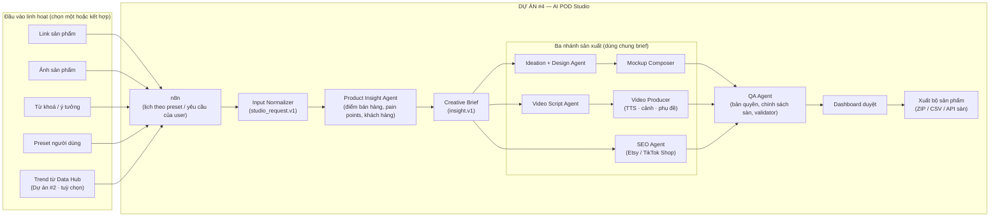

# Dự án #4 — AI POD Studio (Generative AI Mockup, Video & SEO)

> **Nền tảng agent:** OpenClaw (agent runtime + skills) · n8n (workflow orchestration)
> **Số nhóm:** 1 nhóm (2 sinh viên)
> **Ứng dụng độc lập:** Chạy được chỉ với **link sản phẩm, ảnh sản phẩm, từ khoá hoặc preset** của người dùng. Dữ liệu trending từ [Dự án #2 — Spy Trend Data Hub](https://github.com/vinhWater/spy-trend-pod) là **nguồn tích hợp sẵn, không bắt buộc**.
> **Loại đề tài:** Luận văn tốt nghiệp — Hệ thống đa tác nhân Generative AI (hình ảnh, video, văn bản)

---

## 1. Bối cảnh & vấn đề

Để đưa một sản phẩm Print-on-Demand (POD) lên Etsy hoặc TikTok Shop, người bán phải:

1. Hiểu sản phẩm và khách hàng: **điểm bán hàng**, **pain point** mà sản phẩm giải quyết.
2. Làm thiết kế và **mockup** sản phẩm (áo, cốc, poster…).
3. Làm **video sản phẩm** (đặc biệt quan trọng với TikTok Shop).
4. Viết **Title, Description, Tags/Hashtag** chuẩn SEO cho từng sàn.

Mỗi bước thường dùng một công cụ riêng, và nội dung giữa các bước dễ rời rạc (video nói một kiểu, mô tả nói một kiểu). AI POD Studio dùng **một bản phân tích insight sản phẩm duy nhất** làm nền cho cả **mockup, video và SEO**, để mọi thành phẩm cùng truyền tải một thông điệp.

---

## 2. Mục tiêu dự án

| # | Mục tiêu | Tiêu chí đo lường (gợi ý) |
|---|----------|---------------------------|
| G1 | Nhận **đầu vào bất kỳ**: link sản phẩm, ảnh sản phẩm, từ khoá, preset, trend từ Data Hub, hoặc kết hợp | Cả 5 chế độ đầu vào (mục 3.2) chạy end-to-end |
| G2 | Phân tích **insight sản phẩm** (điểm bán hàng, pain points, đối tượng khách hàng) | Insight có nguồn; người dùng đánh giá "đúng & hữu ích" ≥ 80% |
| G3 | Sinh thiết kế + **mockup** POD | ≥ 20 mockup/ngày cho 1 preset, đúng kích thước sàn |
| G4 | Sinh **video sản phẩm theo insight** (kịch bản, giọng đọc, cảnh, phụ đề) | Video dọc 15–60s; kịch bản bám insight; đạt quy định định dạng TikTok Shop |
| G5 | Sinh bộ **nội dung SEO** cho Etsy và TikTok Shop | Tuân thủ giới hạn ký tự/số tag của từng sàn 100% (validator) |
| G6 | Kiểm tra rủi ro & người dùng duyệt trước khi xuất | QA Agent (bản quyền, chính sách sàn) + dashboard duyệt |

---

## 3. Kiến trúc tổng thể



### 3.1. Vai trò của OpenClaw và n8n

| Công nghệ | Vai trò trong hệ thống |
|-----------|------------------------|
| **n8n** | Điều phối: nhận yêu cầu/lịch theo preset, chạy song song ba nhánh sản xuất, gọi dịch vụ sinh ảnh/TTS/video, thông báo duyệt, xuất file |
| **OpenClaw** | Agent: đọc trang sản phẩm, phân tích ảnh, rút insight, sinh ý tưởng/kịch bản/nội dung SEO, tự kiểm tra kết quả |

> Nguyên tắc: **n8n quyết định "khi nào & theo thứ tự nào"**, **OpenClaw quyết định "làm thế nào"** với các tác vụ cần suy luận.

### 3.2. Đầu vào linh hoạt

| Chế độ | Người dùng đưa vào | Hệ thống xử lý |
|--------|--------------------|----------------|
| A. Link sản phẩm | URL trang sản phẩm (Etsy, Amazon, Shopify…) | Đọc tên, mô tả, giá, ảnh, review (nếu được phép) |
| B. Ảnh sản phẩm | Ảnh chụp sản phẩm hoặc file thiết kế có sẵn | Phân tích ảnh (vision): loại sản phẩm, phong cách, màu sắc, chi tiết nổi bật |
| C. Từ khoá / ý tưởng | VD: "áo mèo đen phong cách retro cho Halloween" | Agent tự nghiên cứu để bổ sung insight |
| D. Preset | Cấu hình định sẵn, chạy theo lịch (xem 3.3) | Lấy trend phù hợp (từ Data Hub nếu có) và sản xuất hằng ngày |
| E. Kết hợp | Bất kỳ tổ hợp nào của A–D, có thể thêm trend từ Data Hub | Gộp thông tin, ghi rõ nguồn của từng insight |

```json
{
  "schema_version": "studio_request.v1",
  "request_id": "st_2026_10_29_0003",
  "inputs": [
    { "type": "product_url", "url": "https://example.com/products/black-cat-tee" },
    { "type": "image", "file": "uploads/cat_tee_front.jpg" },
    { "type": "data_hub_trend", "trend_id": "tr_2026_10_29_0012" }
  ],
  "outputs": ["mockup", "video", "seo"],
  "marketplaces": ["etsy", "tiktok_shop"],
  "lang": "en"
}
```

### 3.3. Preset người dùng (ví dụ)

```yaml
preset_id: halloween-pets-tee
source: data_hub            # data_hub | keywords | none
niches: ["pets", "halloween"]
min_trend_score: 0.7
product_types: ["t-shirt", "hoodie"]
style: "retro, vintage, distressed"
colors: ["black", "orange"]
outputs: ["mockup", "video", "seo"]
video:
  aspect_ratio: "9:16"
  duration_s: 30
  voice: "female, friendly"
marketplaces: ["etsy", "tiktok_shop"]
daily_quota: 20
tone: "fun, giftable"
```

### 3.4. Creative Brief chung (`insight.v1`)

Bản phân tích insight là **nguồn chung** cho mockup, video và SEO.

```json
{
  "schema_version": "insight.v1",
  "product": { "type": "t-shirt", "name": "Retro Black Cat Halloween Tee", "attributes": ["cotton", "unisex"] },
  "audience": ["cat lovers", "Halloween gift buyers"],
  "selling_points": [
    { "text": "vintage distressed print", "source": "image" },
    { "text": "great gift for cat owners", "source": "data_hub_review" }
  ],
  "pain_points": [
    { "text": "size runs small on similar shirts", "source": "data_hub_review", "answer": "true-to-size chart included" }
  ],
  "key_message": "A cozy, vintage Halloween tee every cat lover will want",
  "keywords": ["black cat shirt", "retro halloween tee", "cat lover gift"],
  "visual_style": "retro, orange-black palette"
}
```

---

## 4. Các agent & chức năng chi tiết

| Agent / thành phần | Nhiệm vụ | Đầu ra | Mức độ |
|--------------------|----------|--------|--------|
| Input Normalizer | Gộp 5 chế độ đầu vào về `studio_request.v1` | Yêu cầu chuẩn hoá | Bắt buộc |
| Product Insight Agent | Đọc trang/ảnh sản phẩm, dữ liệu Data Hub (nếu có), tự nghiên cứu bổ sung → điểm bán hàng, pain points, khách hàng, thông điệp chính | `insight.v1` | Bắt buộc |
| Ideation + Design Agent | Sinh concept (slogan, hình tượng, phong cách) và thiết kế bằng mô hình sinh ảnh | PNG nền trong suốt, độ phân giải in | Bắt buộc |
| Mockup Composer | Ghép thiết kế lên template sản phẩm (perspective, màu áo) | Ảnh mockup theo kích thước từng sàn | Bắt buộc |
| Video Script Agent | Viết kịch bản **theo insight**: hook (nêu pain point) → giải pháp → điểm bán hàng → CTA; chia cảnh, lời thoại, chữ trên màn hình | Kịch bản + storyboard | Bắt buộc |
| Video Producer | TTS giọng đọc; dựng cảnh từ mockup/ảnh sản phẩm (zoom, pan, chuyển cảnh) hoặc mô hình sinh video; phụ đề; nhạc nền có bản quyền phù hợp | Video MP4 dọc 9:16 | Bắt buộc |
| SEO Agent | Title, Description, Tags/Hashtag cho từng sàn, dùng `keywords` từ brief | Bộ nội dung SEO | Bắt buộc |
| QA Agent | Kiểm tra thương hiệu/nhân vật có bản quyền, từ cấm, claim sai, giới hạn ký tự, nhất quán giữa video – mockup – mô tả | Báo cáo đạt/không đạt | Bắt buộc |
| Dashboard duyệt | Xem, sửa, sinh lại từng phần, duyệt, xuất | Bộ sản phẩm đã duyệt | Bắt buộc |
| Packager | Đóng gói ZIP/CSV hoặc đẩy draft qua API sàn | Bộ sản phẩm sẵn sàng đăng | Khuyến khích (đẩy API) |

### 4.1. Video theo insight — cấu trúc kịch bản mẫu (30s)

| Thời điểm | Cảnh | Nội dung (lấy từ `insight.v1`) |
|-----------|------|-------------------------------|
| 0–3s | Hook | Nêu pain point / câu hỏi gây chú ý |
| 3–12s | Giới thiệu sản phẩm | Mockup + thông điệp chính |
| 12–24s | Điểm bán hàng | 2–3 `selling_points`, mỗi điểm một cảnh |
| 24–30s | CTA | Kêu gọi mua / tặng quà, tên shop |

> Video chỉ được nói những gì có trong brief; QA Agent kiểm tra lời thoại không chứa claim không có nguồn.

### 4.2. Quy tắc SEO theo sàn

| Thành phần | Etsy | TikTok Shop |
|------------|------|-------------|
| Title | Giới hạn ký tự, từ khoá chính ở đầu | Ngắn gọn, nêu rõ sản phẩm + lợi ích |
| Description | Chi tiết: chất liệu, size, chăm sóc | Ngắn, gạch đầu dòng, phù hợp mobile |
| Tags / Hashtag | Số lượng tag tối đa, độ dài mỗi tag giới hạn | Hashtag theo xu hướng TikTok |

> Nhóm phải tra cứu quy định hiện hành của từng sàn (cả định dạng video của TikTok Shop) và mã hoá thành **validator kiểm tra tự động**, không chỉ dựa vào prompt.

---

## 5. Sản phẩm bàn giao

- [ ] Input Normalizer hỗ trợ đủ 5 chế độ đầu vào
- [ ] Product Insight Agent sinh `insight.v1` có nguồn
- [ ] Pipeline mockup: thiết kế + thư viện template (≥ 3 loại sản phẩm)
- [ ] Pipeline video: kịch bản theo insight + TTS + dựng cảnh + phụ đề
- [ ] SEO Agent + validator cho Etsy & TikTok Shop
- [ ] QA Agent (bản quyền, chính sách, nhất quán giữa các thành phẩm)
- [ ] Dashboard duyệt / sửa / sinh lại / xuất
- [ ] Tích hợp Data Hub (Dự án #2) qua Trend API `trend.v1` — chế độ D/E
- [ ] Báo cáo đánh giá: chất lượng insight, chất lượng ảnh & video (user study nhỏ), tỉ lệ đạt validator, thời gian & chi phí trên 1 bộ sản phẩm, **so sánh chất lượng giữa các chế độ đầu vào**

## 6. Gợi ý phân công

| Thành viên | Phụ trách |
|------------|-----------|
| SV1 | Ideation + Design Agent, Mockup Composer, template, Video Script Agent, Video Producer |
| SV2 | Input Normalizer, Product Insight Agent, SEO Agent + validator, QA Agent, dashboard duyệt, tích hợp Data Hub, n8n |

> Video là phần nặng nhất. Nếu tiến độ chậm, ưu tiên **dựng video từ mockup + TTS + phụ đề** (dễ kiểm soát) trước khi thử mô hình sinh video.

---

## 7. Công nghệ đề xuất

| Lớp | Công nghệ |
|-----|-----------|
| Orchestration | n8n (self-hosted, Docker) |
| Agent runtime | OpenClaw + skills tuỳ biến |
| LLM (văn bản + vision) | Cấu hình được (Claude / Gemini / GPT / mô hình mở) |
| Sinh ảnh | Imagen / Gemini Image / Stable Diffusion XL / Flux |
| Xử lý ảnh | Pillow / OpenCV / Sharp |
| TTS | Google Cloud TTS / ElevenLabs / mô hình mở (VD: XTTS) |
| Video | FFmpeg, MoviePy, Remotion; tuỳ chọn: Veo / mô hình sinh video khác |
| Lưu trữ | PostgreSQL, MinIO/S3 |
| Dashboard | Next.js / Streamlit |

---

## 8. Lộ trình gợi ý (16 tuần)

| Tuần | Công việc |
|------|-----------|
| 1–2 | Nghiên cứu OpenClaw/n8n, sinh ảnh, TTS/video, quy tắc SEO & video của sàn |
| 3 | Chốt `studio_request.v1`, `insight.v1`; chốt `trend.v1` với nhóm Dự án #2 |
| 4–6 | Input Normalizer (link, ảnh, từ khoá) + Product Insight Agent |
| 6–9 | Nhánh mockup (Design + Mockup Composer) và nhánh SEO (SEO Agent + validator) |
| 9–12 | Nhánh video (Script Agent + Video Producer) |
| 12–13 | QA Agent, dashboard duyệt, preset chạy theo lịch, tích hợp Data Hub |
| 14 | Đánh giá, user study, tối ưu chi phí |
| 15–16 | Luận văn + demo |

## 9. Rủi ro & lưu ý

- **Bản quyền / thương hiệu** trong thiết kế, video, nhạc nền — QA Agent là bắt buộc.
- **Link sản phẩm của người khác:** chỉ dùng để phân tích insight; không sao chép nguyên thiết kế, ảnh hoặc mô tả của người bán khác.
- **Claim sai trong video/mô tả** — mọi claim phải có trong `insight.v1`.
- **Chi phí sinh ảnh/video** — đặt quota theo ngày, đo chi phí trên mỗi bộ sản phẩm.
- **Phụ thuộc Data Hub:** thấp, vì Studio chạy độc lập; khi Data Hub chưa sẵn sàng, dùng seed data `trend.v1`.
