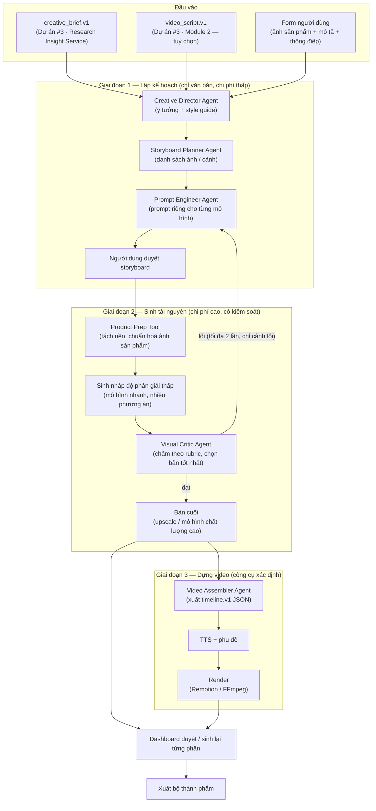

# Dự án #4 — AI POD Studio (Sản xuất hình ảnh & video sản phẩm)

> **Nền tảng agent:** OpenClaw (agent runtime + skills) · n8n (workflow orchestration, hàng đợi tác vụ)
> **Số nhóm:** 1 nhóm (2 sinh viên)
> **Phạm vi:** Chỉ tập trung **tạo hình ảnh và video**. Phần nghiên cứu insight do **Research Insight Service** của [Dự án #3 — Content Affiliate](https://github.com/vinhWater/content-affiliate) đảm nhận; kịch bản video có thể lấy từ Module 2 của Dự án #3.
> **Loại đề tài:** Luận văn tốt nghiệp — Hệ thống đa tác nhân Generative AI cho hình ảnh và video, tối ưu chất lượng trên chi phí

---

## 1. Bối cảnh & vấn đề

Người bán Print-on-Demand (POD) và người làm affiliate cần hình ảnh và video sản phẩm đẹp, đúng thông điệp, số lượng lớn (Etsy, TikTok Shop, Reels, Shorts). Dùng trực tiếp các mô hình sinh ảnh/video gặp ba vấn đề:

1. **Không có chiều sâu:** prompt chung chung → hình đẹp nhưng không truyền tải được điểm bán hàng hay pain point của khách.
2. **Không nhất quán và sai sản phẩm:** mỗi cảnh một phong cách; AI vẽ lại sản phẩm làm sai logo, màu, chi tiết.
3. **Tốn kém:** sinh đi sinh lại đến khi "trúng" một kết quả; video text-to-video có giá cao trên mỗi giây.

AI POD Studio dùng **agent harness** để đưa phần "suy nghĩ" (ý tưởng, storyboard, prompt, đánh giá) lên trước bằng văn bản — rẻ và kiểm soát được — và chỉ gọi mô hình sinh ảnh/video đắt tiền khi kế hoạch đã được duyệt.

---

## 2. Mục tiêu dự án

| # | Mục tiêu | Tiêu chí đo lường (gợi ý) |
|---|----------|---------------------------|
| G1 | Nhận đầu vào từ Dự án #3 **hoặc** chạy độc lập bằng form đơn giản | Cả 3 nguồn đầu vào (mục 3.2) chạy end-to-end |
| G2 | Sinh **bộ hình ảnh** sản phẩm: mockup POD + ảnh bối cảnh (lifestyle) | 1 bộ = 1 mockup + 3–5 ảnh bối cảnh, đúng kích thước sàn |
| G3 | Sinh **video sản phẩm dọc 15–30s** bám thông điệp và kịch bản | Video 9:16 có giọng đọc, phụ đề, đúng thời lượng |
| G4 | **Giữ đúng sản phẩm thật** (logo, màu, chi tiết) | ≥ 95% ảnh/cảnh đạt tiêu chí "đúng sản phẩm" của Visual Critic + kiểm tra tay |
| G5 | **Tối ưu chi phí** | Đo chi phí & thời gian mỗi bộ thành phẩm; so sánh với baseline "prompt trực tiếp" |
| G6 | Human-in-the-loop ở điểm rẻ nhất | Người dùng duyệt storyboard **trước** khi sinh ảnh/video |

---

## 3. Kiến trúc tổng thể



### 3.1. Vai trò của OpenClaw và n8n

| Công nghệ | Vai trò trong hệ thống |
|-----------|------------------------|
| **n8n** | Hàng đợi tác vụ chạy lâu (sinh ảnh/video bất đồng bộ), nhận webhook từ nhà cung cấp mô hình, retry, song song hoá theo cảnh, thông báo duyệt, xuất file |
| **OpenClaw** | Các agent suy luận: Creative Director, Storyboard Planner, Prompt Engineer, Visual Critic, Video Assembler |

> Nguyên tắc: **n8n quyết định "khi nào & theo thứ tự nào"**, **OpenClaw quyết định "làm thế nào"**. Việc sinh pixel do mô hình chuyên dụng làm; việc render video do công cụ xác định làm.

### 3.2. Đầu vào

| Nguồn | Nội dung | Ghi chú |
|-------|----------|---------|
| `creative_brief.v1` | Sản phẩm, ảnh tham chiếu, chi tiết phải giữ (`must_keep`), thông điệp chính, điểm bán hàng, pain points, mood, claim không được nói | Từ Research Insight Service (Dự án #3 · Module 1) |
| `video_script.v1` | Danh sách cảnh, lời thoại, chữ trên màn hình, gợi ý hình ảnh, CTA | Từ Dự án #3 · Module 2; nếu không có, Storyboard Planner tự viết kịch bản ngắn từ creative brief |
| Form người dùng | Ảnh sản phẩm, mô tả ngắn, thông điệp, phong cách mong muốn | **Chế độ độc lập** — Studio vẫn chạy được khi không có Dự án #3 |

> Định dạng `creative_brief.v1` và `video_script.v1` do Dự án #3 định nghĩa (xem README của Dự án #3); ba nhóm cùng chốt trong **tuần 3**. Nhóm #3 giao brief mẫu từ tuần 4 và script mẫu từ tuần 6.

```json
{
  "schema_version": "studio_job.v1",
  "job_id": "job_2026_10_29_0002",
  "inputs": {
    "creative_brief_id": "cb_2026_10_29_0004",
    "video_script_id": "vs_2026_10_29_0004",
    "form": null
  },
  "outputs": {
    "images": { "mockup": 1, "lifestyle": 4, "sizes": ["2000x2000", "1080x1350"] },
    "video": { "aspect_ratio": "9:16", "duration_s": 30, "template": "product-story-v1" }
  },
  "brand_kit": { "colors": ["#1F2937", "#F97316"], "font": "Inter", "logo": "assets/logo.png" },
  "budget": { "max_cost_usd": 2.0, "max_retries_per_shot": 2 }
}
```

---

## 4. Agent harness: chất lượng có chiều sâu nhưng tiết kiệm

Chi phí lớn nhất của Studio nằm ở **sinh ảnh/video**, không phải ở LLM. Vì vậy harness được thiết kế để LLM làm phần suy nghĩ rẻ, còn phần sinh đắt chỉ chạy khi đã chắc chắn.

| Nguyên tắc | Cách làm | Lợi ích |
|-----------|----------|---------|
| **Lên kế hoạch trước, sinh sau** | Agent làm việc bằng văn bản: ý tưởng → storyboard → prompt. Người dùng duyệt storyboard trước khi gọi mô hình sinh | Sửa ở bước văn bản gần như miễn phí |
| **Nháp rẻ → bản cuối đắt** | Sinh 2–4 phương án độ phân giải thấp bằng mô hình nhanh; Visual Critic chọn; chỉ bản được chọn mới upscale / chạy mô hình chất lượng cao | Giảm số lần gọi mô hình đắt |
| **Ghép dựng thay vì sinh toàn bộ** | Video MVP dựng từ ảnh/mockup + chuyển động (zoom, pan, parallax qua template) + TTS + phụ đề. Text-to-video / image-to-video chỉ dùng cho 1–2 cảnh nổi bật vài giây (tuỳ chọn) | Chi phí video thấp và ổn định |
| **LLM xuất timeline, không xuất video** | Video Assembler xuất `timeline.v1` JSON; Remotion/FFmpeg render | Lặp lại được, kiểm thử được, không tốn token khi render lại |
| **Giữ nguyên sản phẩm thật** | Tách nền ảnh sản phẩm → đặt vào bối cảnh do AI sinh (inpainting / outpainting / compositing), không để AI vẽ lại sản phẩm. Với POD: ghép thiết kế lên template mockup | Không sai logo, màu, chi tiết |
| **Đánh giá có giới hạn** | Visual Critic chấm theo rubric; chỉ sinh lại **cảnh bị lỗi**, tối đa 2 lần; hết lượt → đưa người duyệt | Không lặp vô hạn |
| **Tái sử dụng tài nguyên** | Brand kit, template video, ảnh tham chiếu, seed cố định, cache prompt → ảnh | Nhất quán giữa các cảnh, giảm sinh lại |
| **Ngân sách mỗi job** | `budget.max_cost_usd`; n8n dừng job và báo khi vượt | Chi phí đo và kiểm soát được |

### 4.1. Các agent

| Agent / công cụ | Nhiệm vụ | Đầu ra |
|-----------------|----------|--------|
| Creative Director Agent | Từ brief → ý tưởng sáng tạo, style guide (màu, ánh sáng, bố cục, mood), danh sách "phải giữ / không được làm" | `style_guide` |
| Storyboard Planner Agent | Danh sách ảnh cần làm và các cảnh video; mỗi cảnh gắn với một `selling_point` / `pain_point` trong brief; viết kịch bản ngắn nếu không có `video_script.v1` | `storyboard` |
| Prompt Engineer Agent | Viết prompt / tham số riêng cho từng mô hình (sinh ảnh, chỉnh ảnh, image-to-video), kèm ảnh tham chiếu & seed | Danh sách tác vụ sinh |
| Product Prep Tool | Tách nền, chuẩn hoá kích thước/ánh sáng ảnh sản phẩm; ghép thiết kế POD lên template | Ảnh sản phẩm sạch, mockup |
| Image Generation / Editing Tool | Gọi mô hình sinh/chỉnh ảnh (nháp và bản cuối) | Ảnh |
| Visual Critic Agent | Mô hình có khả năng nhìn ảnh chấm theo rubric (mục 4.2), chọn phương án tốt nhất, chỉ ra lỗi cụ thể | Điểm + lý do + yêu cầu sửa |
| Video Assembler Agent | Từ storyboard + ảnh cuối → `timeline.v1` (cảnh, thời lượng, chuyển động, chữ, nhạc) | `timeline.v1` |
| TTS + Subtitle Tool | Giọng đọc từ lời thoại; phụ đề khớp thời gian | Audio + SRT |
| Renderer | Remotion / FFmpeg render từ `timeline.v1` | MP4 |

### 4.2. Rubric của Visual Critic (gợi ý)

| Tiêu chí | Câu hỏi kiểm tra |
|----------|------------------|
| Đúng sản phẩm | Logo, màu, hình dáng, chi tiết `must_keep` có giữ nguyên không? |
| Đúng thông điệp | Ảnh/cảnh có thể hiện đúng `selling_point` / `pain_point` được giao không? |
| Chất lượng kỹ thuật | Có lỗi tay/mặt, vật thể méo, chữ sai chính tả, vùng mờ không? |
| Nhất quán | Có đúng style guide và đồng bộ với các cảnh khác không? |
| Tuân thủ | Có thương hiệu/nhân vật có bản quyền, nội dung bị cấm, claim trong `do_not_claim` không? |
| Kỹ thuật sàn | Đúng tỉ lệ khung hình, kích thước, vùng an toàn cho chữ trên TikTok không? |

### 4.3. Timeline video (`timeline.v1`)

```json
{
  "schema_version": "timeline.v1",
  "job_id": "job_2026_10_29_0002",
  "fps": 30,
  "size": [1080, 1920],
  "tracks": {
    "video": [
      { "scene": 1, "start_s": 0, "end_s": 3, "asset": "img/hook.png", "motion": "slow_zoom_in" },
      { "scene": 2, "start_s": 3, "end_s": 9, "asset": "img/lumbar_closeup.png", "motion": "pan_left" }
    ],
    "text": [
      { "start_s": 0.3, "end_s": 2.8, "content": "Đau lưng khi ngồi lâu?", "style": "headline" }
    ],
    "audio": [
      { "type": "voiceover", "file": "audio/vo.mp3", "start_s": 0 },
      { "type": "music", "file": "music/calm_01.mp3", "volume": 0.2 }
    ],
    "subtitles": "audio/vo.srt"
  },
  "cta": { "start_s": 26, "end_s": 30, "content": "Xem giá ở link bên dưới" }
}
```

---

## 5. Phạm vi MVP

| Hạng mục | MVP (bắt buộc) | Mở rộng (khuyến khích) |
|----------|----------------|------------------------|
| Loại sản phẩm | 1 loại (VD: áo thun POD **hoặc** 1 sản phẩm affiliate có ảnh thật) | Thêm loại sản phẩm |
| Bộ ảnh | 1 mockup + 3–5 ảnh bối cảnh | Banner, ảnh so sánh, carousel |
| Video | 1 template dọc 15–30s dựng từ ảnh + TTS + phụ đề | Cảnh image-to-video cho hook; nhiều template |
| Đầu vào | Form người dùng + `creative_brief.v1` | `video_script.v1` từ Dự án #3 |
| Đánh giá | Visual Critic + người duyệt | So sánh A/B với baseline "prompt trực tiếp" |

---

## 6. Sản phẩm bàn giao

- [ ] Pipeline 3 giai đoạn: lập kế hoạch → sinh tài nguyên → dựng video
- [ ] Creative Director, Storyboard Planner, Prompt Engineer, Visual Critic, Video Assembler
- [ ] Product Prep (tách nền, ghép mockup) — giữ đúng sản phẩm
- [ ] Template video Remotion + TTS + phụ đề
- [ ] Rubric Visual Critic + bộ ảnh kiểm thử có gán nhãn
- [ ] Dashboard: duyệt storyboard, xem/sinh lại từng ảnh/cảnh, xuất
- [ ] Tích hợp `creative_brief.v1` (và `video_script.v1` nếu có) từ Dự án #3
- [ ] Báo cáo đánh giá: chất lượng (user study nhỏ), tỉ lệ "đúng sản phẩm", số lần sinh lại trung bình, **chi phí & thời gian mỗi bộ thành phẩm so với baseline**

## 7. Gợi ý phân công

| Thành viên | Phụ trách |
|------------|-----------|
| SV1 — Hình ảnh | Creative Director, Prompt Engineer, Product Prep, sinh/chỉnh ảnh, Visual Critic, rubric |
| SV2 — Video | Storyboard Planner, Video Assembler, `timeline.v1`, template Remotion, TTS & phụ đề, n8n hàng đợi, dashboard |

---

## 8. Công nghệ đề xuất

| Lớp | Công nghệ |
|-----|-----------|
| Orchestration | n8n (self-hosted, Docker) — hàng đợi job, webhook |
| Agent runtime | OpenClaw + skills tuỳ biến |
| LLM (văn bản + vision) | Cấu hình được (Claude / Gemini / GPT / mô hình mở) |
| Sinh / chỉnh ảnh | Imagen / Gemini Image / Stable Diffusion XL / Flux (+ inpainting, ControlNet / IP-Adapter cho ảnh tham chiếu) |
| Tách nền | rembg / SAM / dịch vụ tương đương |
| Image-to-video (tuỳ chọn) | Veo / mô hình tương đương — chỉ cho cảnh nổi bật |
| TTS | Google Cloud TTS / ElevenLabs / mô hình mở (VD: XTTS) |
| Dựng video | Remotion (template React), FFmpeg |
| Lưu trữ | PostgreSQL, MinIO/S3 |
| Dashboard | Next.js / Streamlit |

---

## 9. Lộ trình gợi ý (16 tuần)

| Tuần | Công việc |
|------|-----------|
| 1–2 | Nghiên cứu OpenClaw/n8n, mô hình sinh/chỉnh ảnh, Remotion, TTS; quy định ảnh/video của sàn |
| 3 | **Chốt `creative_brief.v1`, `video_script.v1` với Dự án #3**; chốt `studio_job.v1`, `timeline.v1` |
| 4–6 | Form đầu vào, Creative Director, Storyboard Planner, Prompt Engineer (chạy trên brief mẫu từ #3) |
| 6–9 | Product Prep, sinh ảnh nháp → bản cuối, Visual Critic + rubric |
| 8–11 | Video Assembler, template Remotion, TTS, phụ đề (dùng script mẫu từ #3) |
| 11–12 | n8n hàng đợi + ngân sách, dashboard duyệt, sinh lại từng phần |
| 13 | Tích hợp API thật với Dự án #3 |
| 14 | Đánh giá: user study, so sánh baseline, chi phí |
| 15–16 | Luận văn + demo |

## 10. Rủi ro & lưu ý

- **Chi phí sinh ảnh/video:** bắt buộc ngân sách mỗi job, nháp rẻ trước, giới hạn số lần sinh lại.
- **Sai sản phẩm:** không để AI vẽ lại sản phẩm thật; luôn ghép từ ảnh sản phẩm đã tách nền.
- **Bản quyền:** thiết kế, ảnh tham chiếu, nhạc nền phải có quyền sử dụng; Visual Critic kiểm tra thương hiệu/nhân vật có bản quyền.
- **Claim sai:** chữ trên màn hình và lời thoại chỉ dùng nội dung có trong brief/script; tôn trọng `do_not_claim`.
- **Phụ thuộc Dự án #3:** thấp — Studio chạy được bằng form người dùng; brief/script mẫu được giao sớm.
